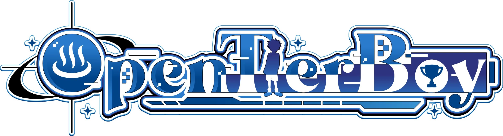
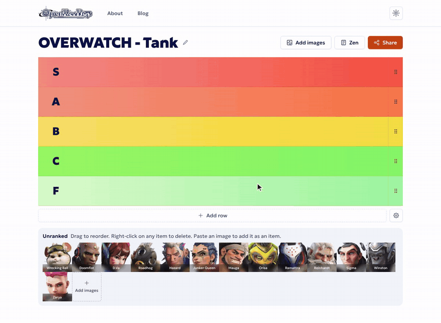
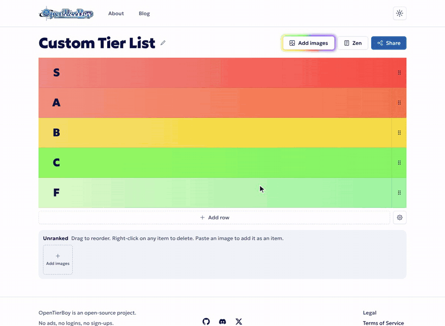
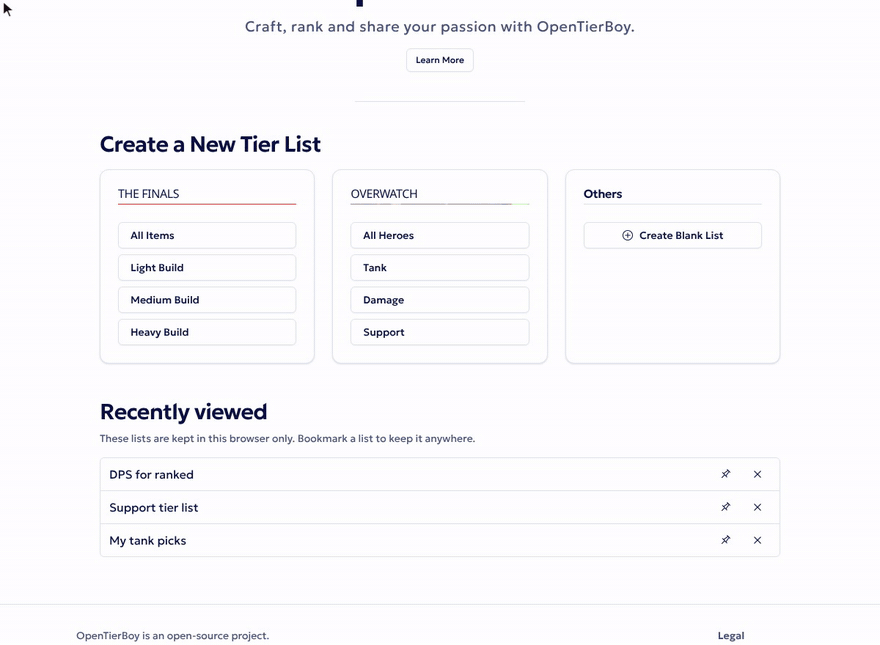
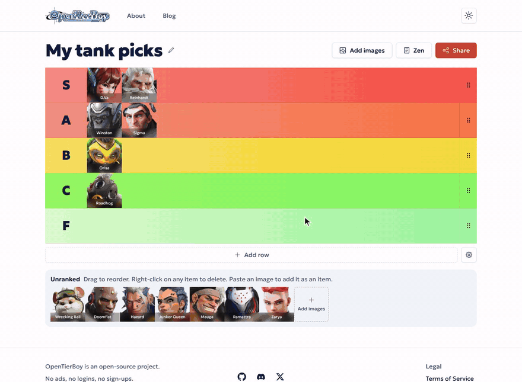

  <a href="https://opentierboy.com">
    <picture>
      
    </picture>
  </a>

  
  
  

  

## 🚀 Getting Started

1. Visit [https://opentierboy.com](https://opentierboy.com)
2. Choose a template or start from scratch
3. Craft your tier list by dragging and dropping items
4. Add more images from our image set templates or add your own images if desired
5. Share your creation using _Copy Jutsu_ (URL) or capture a _Freeze Frame_ (screenshot)

## 🌟 Features

- **Tier Studio**: Modern, user-friendly interface for effortless tier list creation
- **No Login Required**: Create and share without an account
- **BYOI (Bring Your Own Images)**: Upload, paste or drop pictures from your device, or add images from other websites by
  their address
- **Copy Jutsu**: Easily share your rankings with a stateful URL
- **Freeze Frame**: Capture your rankings as an image. A downloaded Freeze Frame reopens as an editable list
- **Recently Viewed**: The lists you opened come back on the home page. Pin the ones you want to keep
- **Appearance**: Light, Dark or System mode, each game's own colours, and a Modern or Classic font
- **Zen**: Hide the buttons and rank by dragging, without distractions
- **Privacy First**: No database, no logins, no sign-ups, no ads, no tracking. Your list lives in its link.
  Images you upload or paste stay in your browser and never reach our server. Images from trusted sites load
  straight from those sites; images from other sites load only after you allow them.

## 🎬 See It in Action

<table>
  <tr>
    <td width="50%" valign="top">
      <b>Bring your own images</b> 
      Upload, paste or drop pictures. They stay in your browser. 
      
    </td>
    <td width="50%" valign="top">
      <b>Freeze Frame</b> 
      Capture the list as a picture, and download it. 
      
    </td>
  </tr>
  <tr>
    <td width="50%" valign="top">
      <b>Reopen a Freeze Frame</b> 
      A downloaded Freeze Frame opens again as an editable list. 
      
    </td>
    <td width="50%" valign="top">
      <b>Recently viewed</b> 
      Lists you opened come back on the home page. Pin the ones you keep. 
      
    </td>
  </tr>
  <tr>
    <td width="50%" valign="top">
      <b>Appearance</b> 
      Light, Dark or System, each game's colours, and a Modern or Classic font. 
      
    </td>
    <td width="50%" valign="top">
      <b>Zen</b> 
      Hide the buttons and rank without distractions. 
      
    </td>
  </tr>
</table>

## ♨️ Open Source

OpenTierBoy is proud to be an open-source project. We believe in the power of community-driven development and welcome
contributions from developers around the world. By being open-source, we ensure transparency, foster innovation, and
provide a platform for learning and collaboration.

- **Transparency**: Our code is open for review, ensuring security and trust.
- **Community-Driven**: Features and improvements are guided by user needs and community input.
- **Educational**: Developers can learn from and build upon our codebase.
- **Customizable**: Users can fork and modify the project to suit their specific needs.

## 🤝 Contributing

We welcome contributions to OpenTierBoy! Whether you're fixing bugs, adding new features, or contributing new image
sets, your input is valuable.

For detailed information on how to contribute, including guidelines for code contributions and instructions for
submitting new image sets, please see our [CONTRIBUTING](CONTRIBUTING.md) file.

## 🐛 Reporting Issues

Found a bug or have a suggestion? Open an issue on GitHub:

1. Go to the [Issues](https://github.com/infinia-yzl/opentierboy/issues) tab.
2. Click "New Issue".
3. Choose the appropriate template (Bug Report, Feature Request / Feedback, or Image Update or Addition).
4. Provide a clear title and detailed description.
5. Add relevant labels if necessary.

## 🤖 Built with AI Agents

OpenTierBoy is built mostly by AI coding agents (Claude, by Anthropic). The work is spec-driven: the owner writes
what to build, the agents follow the rules in [CLAUDE.md](CLAUDE.md), and automated tests check the result. The owner
makes some checks by hand and may not review every line of code.

OpenTierBoy is provided "as is", without warranty of any kind, and its authors are not liable for any damages arising
from its use. See sections 15 and 16 of the [LICENSE](LICENSE).

## 📜 License

This project is licensed under the GNU Affero General Public License v3.0 (AGPL-3.0).
This means:

- You can freely use, modify, and distribute the software.
- You must provide appropriate attribution to the original project and authors.
- You must include a copy of the full license text with any distribution of the software or derivative works.
- If you modify OpenTierBoy and provide it as a service over a network, you must make your modified source code
  available to users of that service under the same AGPL-3.0 license.
- Any derivative works must also be licensed under AGPL-3.0.
- You must clearly indicate any changes made to the original software.

See the [LICENSE](LICENSE) file for full details.

## 🌐 Community

Join our [Discord server](https://discord.gg/CEtDSHV38b) to share your tier lists, discuss features, and connect
with other rankers!

## 🙏 Credits and Attributions

OpenTierBoy is built on the shoulders of giants. We're grateful to the creators and maintainers of all our dependencies,
including but not limited to:

- [Next.js](https://nextjs.org/) - The React framework for production.
- [shadcn/ui](https://ui.shadcn.com/) - Beautifully designed components built with Radix UI and Tailwind CSS.
- [dnd-kit](https://github.com/clauderic/dnd-kit) - Drag and drop toolkit for React (a copy lives in
  `packages/dnd-kit`, see [docs/reference/drag-and-drop.md](docs/reference/drag-and-drop.md)).
- [html2canvas-pro](https://yorickshan.github.io/html2canvas-pro/) & [html2canvas](https://html2canvas.hertzen.com/) -
  Screenshots with JavaScript.
- [lz-string](https://github.com/pieroxy/lz-string/) - LZ-based compression algorithm for JavaScript.

These are just a few examples of the many excellent libraries we use. For a full list of dependencies, please see our
package.json file. Every package contributes to making OpenTierBoy what it is today.

---

Craft, Rank, and Share Your Passion with OpenTierBoy!
