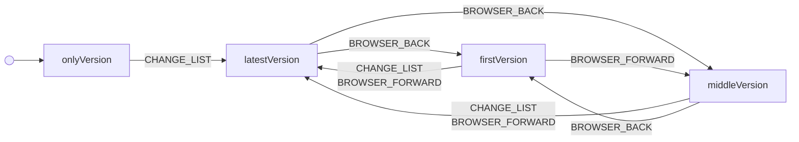

# history

Browser history as the list’s undo: each change adds a version, Back and Forward step between versions, a change after Back drops the later ones, and label settings add no version.

Drawn from `tests/machines/history.ts` by `npm run machines:diagrams`. Do not edit this file.

