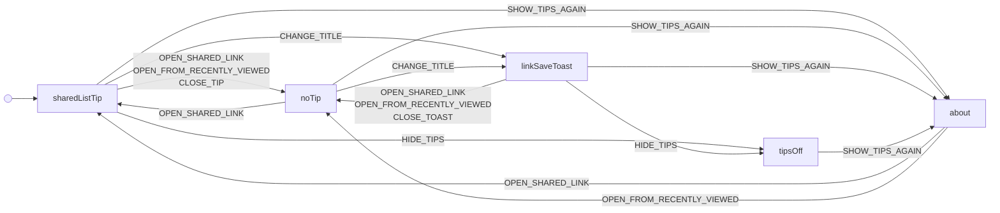

# tipsSharedList

The shared-list tip: it shows for a link opened fresh until the browser saw it or the link-save toast, ends with Close, Hide tips or the first change, and About turns it on again.

Drawn from `tests/machines/tips-shared-list.ts` by `npm run machines:diagrams`. Do not edit this file.

