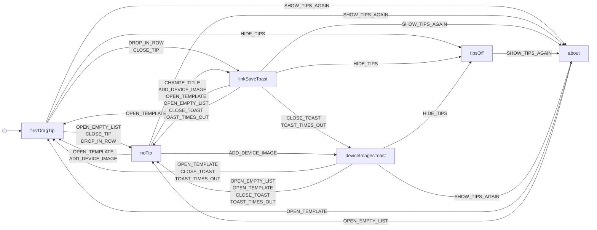

# tips

The first-drag tip and the link-save and device-images toasts of one browser: one at a time, the others wait, an ended tip is seen, Hide tips turns them off and About turns them on again.

Drawn from `tests/machines/tips.ts` by `npm run machines:diagrams`. Do not edit this file.

