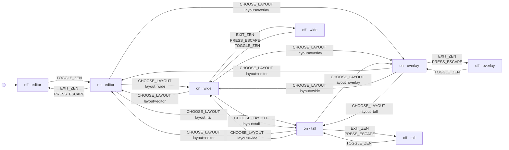

# zenLayout

Zen on and off, and the layout of the Zen bar’s Layout menu. The layout stays when Zen goes off and on again.

Drawn from `tests/machines/zen-layout.ts` by `npm run machines:diagrams`. Do not edit this file.

